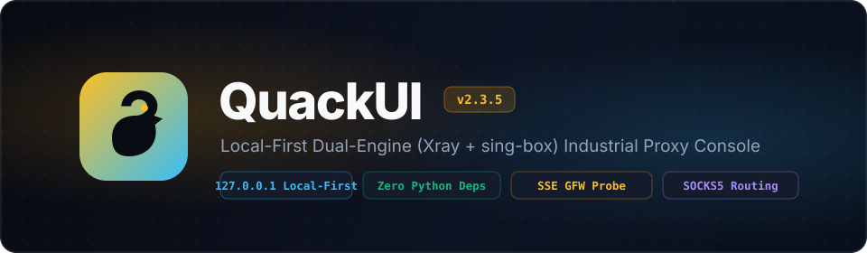
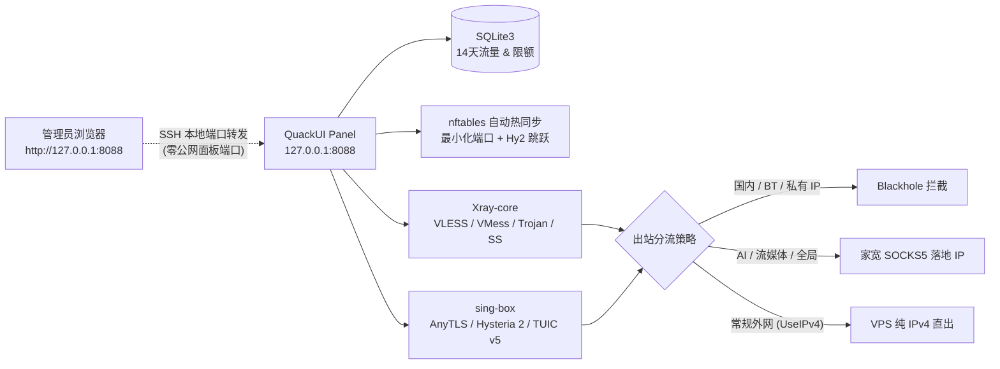

<div align="center">



<br/>

[](https://github.com/FanDuck/QuackUI/releases)
[](./LICENSE)
[](./app.py)
[](#支持协议矩阵)
[](#快速安装)

<p>
  <strong>简体中文</strong> · <a href="./README_EN.md">English</a>
</p>

<p>
  <strong>轻量、本地优先、零第三方依赖的 Xray + sing-box 双引擎工业级节点管理面板</strong><br/>
  由 <strong>FanDuck</strong> 打造 · 默认仅绑定 <code>127.0.0.1</code>，绝不向公网暴露管理端口
</p>

</div>

---

## 为什么选择 QuackUI？

传统 Web 面板通常功能臃肿、依赖复杂，且默认向公网开放管理端口，容易成为主动探测与封锁的目标。**QuackUI** 从零开始围绕 **防封锁、极简透明、双引擎、开箱即用** 重新设计：

| 特性维度 | QuackUI | 传统面板（x-ui / 3x-ui） |
| :--- | :--- | :--- |
| **公网暴露面** | **零暴露**（仅监听 `127.0.0.1` + SSH 隧道访问） | 默认公网端口，需额外配反代/域名隐藏 |
| **内核架构** | **Xray + sing-box 双引擎**（无节点时 sing-box 自动休眠） | 单 Xray 内核 |
| **依赖与体积** | **纯 Python 3 标准库 + SQLite3**，零第三方包，内存 < 50MB | 独立编译二进制 + 较重前端框架 |
| **代码透明度** | 极简可读源码，单文件后端随时可逐行审计 | 大型多模块工程 |
| **防封特色工具** | **IPv6 `/64` 一键轮换** + **SSE 实时五维体检 & 中国大陆多点 GFW 检测** | 需借助外部网站手动排查 |
| **防火墙联动** | **自动原子热同步 `nftables`**（增删节点自动放行/回收端口 + Hy2 端口跳跃） | 需手动维护防火墙规则 |
| **家宽落地路由** | 内置 **SOCKS5 家宽一键路由**（全局 / AI 流媒体 / 自定义域名，双引擎同步） | 需手写复杂 Outbound / Routing JSON |
| **隐私与离线** | 本地 `qrencode` 离线生成 SVG 二维码，无外部 CDN / 统计上报 | 部分版本依赖外部资源 |

---

## 架构概览



---

## 支持协议矩阵

内置 **6 套一键抗封场景模板** 与 **自由自定义构建器**，所有协议均自动生成标准分享链接、离线 SVG 二维码与 **Clash / Mihomo YAML**：

| 协议组合 | 驱动引擎 | 抗封锁与场景特点 | 防火墙联动 |
| :--- | :--- | :--- | :--- |
| **VLESS + XHTTP + Reality** | `Xray` | 2026 抗封王牌，HTTP/2 分片 + 随机填充 + 借用外部合法证书 | 自动放行 TCP |
| **VLESS + Vision + Reality** | `Xray` | 经典直连主力，零域名、稳定低延迟 | 自动放行 TCP |
| **AnyTLS** | `sing-box` | 新一代抗 TLS-in-TLS 指纹协议，自带早期填充与会话复用 | 自动放行 TCP |
| **Hysteria 2** | `sing-box` | QUIC/UDP + Brutal 拥塞控制，晚高峰高丢包环境利器 | 自动放行 UDP + **端口跳跃 DNAT** |
| **TUIC v5** | `sing-box` | 轻量 QUIC 0-RTT，低延迟、对运营商 QoS 更友好 | 自动放行 UDP |
| **Shadowsocks-2022** | `Xray` | `2022-blake3-aes-128/256-gcm` 极速低开销 | 自动放行 TCP + UDP |
| **VMess / Trojan** | `Xray` | 支持 `RAW` / `WS` / `XHTTP` / `gRPC` 自由搭配 | 自动放行 TCP |

---

## 核心功能一览

- **📊 工业级实时仪表盘**：微点阵暗黑/浅色双主题、交互式开屏引导与卡片微光、服务器环境信息条（OS / Kernel / BBR / IPv4 / IPv6）、5 秒实时速率折线图 + SQLite **近 14 天持久化流量柱状图**。
- **🩺 实时流式五维体检 & GFW 阻断检测（SSE）**：点击体检实时滚动展示检测过程与时间戳终端日志——① 伪装 SNI 健康度 ② Reality 访问 Google 延迟 ③ 实际出口 IP 校验 ④ 服务端国内拦截校验 ⑤ **基于 Globalping 的中国大陆多城市 TCP 端口 GFW 阻断实测**（疑似阻断时自动弹出「一键换 IPv6 救急」）。
- **👥 单节点多用户 & 限额自动停用**：按设备（手机 / 电脑 / iPad）添加独立子用户与二维码；支持设置月流量上限（GB）与到期日期，后台每 60 秒自动检查并停用超限/到期节点，支持一键清零流量。
- **🏠 家宽 SOCKS5 出口路由**：支持快捷粘贴解析 `ip:port:user:pass` / `socks5://user:pass@ip:port`，一键测试家宽落地 IP / 国家 / 运营商 / 延迟，支持全局、AI & 流媒体（ChatGPT / Claude / Gemini / Netflix / TikTok）、自定义域名三种模式。
- **📦 聚合订阅 & 在线 JSON 编辑器**：一键导出全节点 Base64 订阅、明文列表与 Clash `url-test` 完整配置；内置带语法与内核校验的 `Xray` / `sing-box` 原始 JSON 编辑器。
- **🔧 内核版本管理 & 一键备份**：直接从 GitHub 拉取 `XTLS/Xray-core` 最近 20 个官方版本，支持一键升级或任意历史版本降级（**切换前自动备份旧二进制，校验失败自动回滚**）；支持一键安装/升级 `sing-box`、更新 GeoIP/GeoSite 与打包下载 `.tar.gz` 完整配置备份。

---

## 快速安装

支持 **Debian 12 / 13**、**Ubuntu 22.04 / 24.04**（`amd64` / `arm64`）：

```bash
git clone https://github.com/FanDuck/QuackUI.git
cd QuackUI
sudo bash install.sh
```

> 安装脚本会自动安装 `python3`、`qrencode`、`Xray-core`，自动初始化带本地 Stats API（`127.0.0.1:10085`）的基础配置，生成随机强密码并启动 `quackui.service`。

### 安全访问面板（SSH 本地隧道）

在你的本地电脑终端运行（将 `YOUR_SERVER_IP` 替换为你的服务器 IP）：

```bash
ssh -N -L 8088:127.0.0.1:8088 root@YOUR_SERVER_IP
```

保持终端窗口运行，在浏览器打开 **`http://127.0.0.1:8088`**，输入安装时输出的初始密码即可进入控制台（登录后可在「内核与设置」中随时在线修改密码）。

<details>
<summary><b>使用 FinalShell / Termius 图形化配置隧道（点击展开）</b></summary>

1. 打开服务器连接配置 → 找到 **隧道（Tunnel / Port Forwarding）** → 添加一条 **本地转发（Local）**
2. 本地监听地址 / 端口：`127.0.0.1` / `8088`
3. 目标主机 / 端口：`127.0.0.1` / `8088`
4. 保存并连接 SSH 后，直接在浏览器访问 `http://127.0.0.1:8088` 即可。

</details>

<details>
<summary><b>升级与常用运维命令（点击展开）</b></summary>

```bash
# 查看运行状态与日志
sudo systemctl status quackui
sudo journalctl -u quackui -n 50 --no-pager

# 更新 QuackUI 到最新版
cd /opt/quackui && git pull && sudo systemctl restart quackui
```

</details>

---

## 目录结构

```text
/opt/quackui/
├── app.py            # 纯 Python 3 标准库后端 + SQLite3 流量采集 + 双引擎控制
├── web/
│   ├── login.html    # 工业级登录页（中英文切换 + 密码可见开关）
│   └── index.html    # 双引擎控制台（原生 HTML/CSS/Canvas，零前端依赖）
├── assets/
│   └── banner.svg    # QuackUI 矢量项目横幅
├── install.sh        # Debian / Ubuntu 一键安装脚本
├── README.md         # 中文文档
├── README_EN.md      # English Documentation
└── .gitignore        # 自动忽略 config.json / singbox.json / certs/ / quackui.db
```

---

## 安全设计说明

- **默认不暴露公网**：面板仅绑定 `127.0.0.1:8088`，Xray Stats API 仅绑定 `127.0.0.1:10085`。
- **强密码存储与防爆破**：登录密码使用 `PBKDF2-SHA256`（100,000 次迭代 + 随机盐）保存于权限 `600` 的 `config.json`，连续输错 5 次自动锁定 5 分钟。
- **配置修改防炸机**：所有配置变更与内核切换均先执行 `xray run -test` / `sing-box check` 校验，不通过直接拒绝或自动回滚旧二进制。

## 免责声明 & License

本项目仅用于网络技术学习、个人服务器运维与合法合规的跨地域网络研究，请严格遵守所在国家与地区的法律法规。

Licensed under the [MIT License](./LICENSE) © 2026 **FanDuck**.
