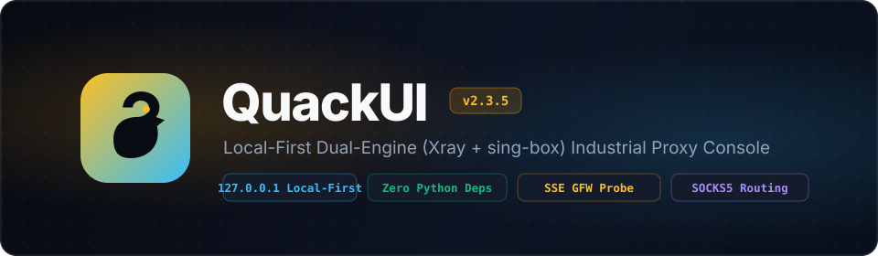

<div align="center">



<br/>

[](https://github.com/FanDuck/QuackUI/releases)
[](./LICENSE)
[](./app.py)
[](#supported-protocols)

<p>
  <a href="./README.md">简体中文</a> · <strong>English</strong>
</p>

<p>
  <strong>Lightweight, Local-First, Zero-Dependency Dual-Engine (Xray + sing-box) Proxy Console</strong><br/>
  Built by <strong>FanDuck</strong> · Binds strictly to <code>127.0.0.1</code> — zero public management port exposure.
</p>

</div>

---

## Highlights

- **Local-First Security**: Binds only to `127.0.0.1:8088` and is accessed via SSH local port forwarding. PBKDF2-SHA256 salted password hashing + brute-force lockout + `escHtml` XSS protection.
- **Zero Python Dependencies**: Pure Python 3 standard library + built-in SQLite3 (< 50 MB RAM peak). Offline SVG QR codes generated via `qrencode`.
- **Dual-Engine Architecture (Xray + sing-box)**:
  - **Xray-core**: `VLESS + XHTTP + Reality`, `VLESS + Vision + Reality`, `VMess`, `Trojan`, `Shadowsocks-2022` with flexible transport (`RAW` / `WS` / `XHTTP` / `gRPC`) & security (`Reality` / `TLS` / `None`).
  - **sing-box**: `AnyTLS`, `Hysteria 2` (with automatic `nftables` UDP port hopping), and `TUIC v5`. Sleeps automatically when unused.
- **Atomic `nftables` Firewall Sync**: Automatically opens exact TCP/UDP + IPv4/IPv6 ports on node creation and reclaims them on disable/delete.
- **Live SSE 5D Diagnostics & GFW Probe**: Streams real-time checks for SNI TLS 1.3 health, Reality E2E latency, outbound IPv4 check, CN block verification, and multi-city China TCP port probing via Globalping.
- **Residential SOCKS5 Chained Outbound**: One-click paste parser (`ip:port:user:pass` / `socks5://`), exit IP & ASN tester, and Global / AI & Streaming / Custom Domain routing synced across both Xray and sing-box.
- **3x-ui Grade Management**: Per-node multi-client management, traffic quotas & expiration auto-enforcement (checked every 60s), full-node Base64 & Clash/Mihomo subscription export, live JSON config editor with validation, and Xray core version manager with auto-rollback.

## Quick Start

Supported OS: **Debian 12 / 13**, **Ubuntu 22.04 / 24.04** (`amd64` / `arm64`).

```bash
git clone https://github.com/FanDuck/QuackUI.git
cd QuackUI
sudo bash install.sh
```

Create an SSH tunnel from your local machine:

```bash
ssh -N -L 8088:127.0.0.1:8088 root@YOUR_SERVER_IP
```

Open **`http://127.0.0.1:8088`** in your browser and sign in with the generated password.

## License

[MIT License](./LICENSE) © 2026 **FanDuck**.
